# How Stellata's catalogue is built

A plain-language walkthrough of the data pipeline: which published
astronomical datasets go in, what decisions the build makes along the
way, and what the viewer in your browser finally loads. It is written
for a reader who knows the data sources — or is simply curious — but
not this codebase. Citations and the physical rationale behind each
decision live in `SCIENCE.md` and its per-topic companions; the
contracts for membership, identifiers and names are
[the catalogue-driver contract](catalog-driver.md) and
[the star-naming contract](star-naming.md).

The flowchart renders natively in GitHub's markdown viewer.

```mermaid
flowchart TD

  subgraph SRC["Published datasets — frozen local copies"]
    GAIA["Gaia DR3<br/>positions · parallaxes · motions ·<br/>G, BP, RP brightness · radial velocities ·<br/>binary-orbit fits · temperatures ·<br/>synthetic photometry · every star to G 11"]
    BJ["Bailer-Jones et al.<br/>probabilistic distances from Gaia parallaxes"]
    HIP["Hipparcos, original and new reduction<br/>bright-star astrometry · printed V and B−V ·<br/>double-star flags"]
    TYC["Tycho-2<br/>positions, motions and brightness<br/>for stars Gaia misses"]
    CLASSIC["Classic designation cross-indexes<br/>Tycho-2 HD identifications · Bright Star<br/>Catalogue · Bayer and Flamsteed index ·<br/>CNS5 nearby stars · Gliese"]
    WGSN["IAU star-name working group<br/>approved names · Greek-letter designations"]
    SIMBAD["SIMBAD<br/>spectral types · cross-identifications ·<br/>cited values"]
    GCVS["GCVS<br/>variable-star periods and amplitudes"]
    WDS["WDS · ORB6 · MSC<br/>double stars · published orbits ·<br/>multiple-system hierarchies"]
    ATHYG["AT-HYG v3.3, frozen<br/>which identifiers name one star ·<br/>still read by double-star matching"]
    EDEN["Edenhofer et al. 3D dust map"]
    ZUCKER["Zucker et al.<br/>molecular-cloud catalogues"]
    PELG["Pelgrims et al.<br/>Local Bubble surface"]
    LVDB["Local Volume Database, Pace<br/>nearby galaxies"]
    SKY["Stellarium figures ·<br/>IAU constellation boundaries"]
    JPL["JPL Horizons<br/>planet orbits · deep-space probes"]
  end

  PULL["Every network pull and offline bake is a step<br/>with a committed record. A stale one stops the<br/>build, which names the command to run.<br/>The build itself never touches the network."]
  PULL -.-> SRC

  subgraph MULT["Multiple-star assembly"]
    M1["Match every catalogued double-star<br/>component to a real, identified star"]
    M2["Choose the most trustworthy position<br/>and motion for each member"]
    M3["Choose the best published orbit<br/>for each pair"]
    M4["Separate true binaries from chance<br/>alignments — keep only bound pairs"]
    M5["Fill in each member's brightness<br/>and spectral type"]
    M1 --> M2 --> M3 --> M4 --> M5
  end

  subgraph IDN["Identity — which stars exist and what they are called"]
    I1["Join the classic cross-indexes into one<br/>Gaia-keyed label table, refusing matches<br/>whose brightness disagrees"]
    I2["Compile the IAU naming tables"]
    I3["List every Gaia source the identity checks<br/>must weigh — the astrometry request"]
    I4["Decide membership: every star a primary<br/>catalogue names, plus every Gaia star to V 11"]
    I5["Bind each record to one Gaia source,<br/>or queue it for a recorded human review"]
    I6["Drop labels no primary catalogue attests"]
    I3 --> I4
    I1 --> I4
    I4 --> I5 --> I6
  end

  subgraph CATG["Star-catalogue assembly"]
    C1["Walk the membership list — set aside,<br/>on a ledger, any record no source can place"]
    C2["Distance — best available measurement wins"]
    C3["Direction and space motion —<br/>most trustworthy astrometry wins"]
    C4["Brightness and colour index"]
    C5["Subtract foreground dust dimming<br/>and reddening"]
    C6["Spectral class, temperature, physical size"]
    C7["Give bound systems one shared distance"]
    C8["Add companions no catalogue lists,<br/>and count each photon once"]
    C9["Names, variables, constellations"]
    C10["Assign every star a permanent identifier"]
    C1 --> C2 --> C3 --> C4 --> C5 --> C6 --> C7 --> C8 --> C9 --> C10
  end

  ORB["Package the orbits — compact per-pair<br/>orbital elements for live motion"]

  LIN["Record lineage — every stage's decision about<br/>every record, with a reason and the source rows<br/>it rests on, compared build to build"]

  subgraph ENV["Surroundings — built independently of the star chain"]
    E1["Molecular clouds: fitted shapes, plus true<br/>irregular silhouettes traced from the dust map"]
    E2["3D dust cube — dims and reddens<br/>stars behind dust"]
    E3["Local Bubble shell — the cavity wall<br/>the Sun sits inside"]
    E4["Nearby galaxies out to 2 Mpc"]
    E5["Permanent identifiers for clouds and galaxies,<br/>from the same registry as the stars"]
    E6["Planet orbits, probe trajectories,<br/>planet and ring textures"]
    E1 --> E5
    E4 --> E5
  end

  subgraph CHECK["Cross-checks"]
    V1["Output counts vs expected snapshots —<br/>unexplained drift fails the build"]
    V2["Lineage tripwires and membership parity —<br/>every record accounted for"]
    V3["Named stars and a SIMBAD sample<br/>vs the built catalogue"]
    V4["Distances vs independently measured<br/>supergiants, on demand"]
  end

  subgraph VIEW["In the browser"]
    W1["Load the catalogue, orbits,<br/>and surroundings"]
    W2["Advance every star to the displayed date<br/>along its space velocity"]
    W3["Binaries orbit live · eclipsing pairs dim<br/>on schedule · variables pulse on their<br/>real periods"]
    W4["Render each star with its physical colour,<br/>dust dimming and reddening computed from<br/>the camera's actual viewpoint"]
    W1 --> W2 --> W3 --> W4
  end

  GAIA --> MULT
  HIP --> MULT
  SIMBAD --> MULT
  WDS --> MULT
  ATHYG --> MULT

  GAIA --> IDN
  CLASSIC --> IDN
  WGSN --> IDN
  SIMBAD --> IDN
  ATHYG --> IDN
  I3 -.->|requested sources| GAIA

  GAIA --> CATG
  BJ --> CATG
  HIP --> CATG
  TYC --> CATG
  CLASSIC --> CATG
  SIMBAD --> CATG
  GCVS --> CATG
  SKY --> CATG

  EDEN --> ENV
  ZUCKER --> ENV
  PELG --> ENV
  LVDB --> ENV
  JPL --> ENV

  MULT -->|bound pairs| IDN
  IDN -->|membership + labels + bindings| C1
  MULT -->|companions + pair geometry| CATG
  ENV -->|dust cube| C5

  MULT --> ORB
  CATG --> ORB

  IDN --> LIN
  CATG --> LIN
  LIN --> CHECK
  MULT --> CHECK
  CATG --> CHECK

  CATG --> VIEW
  ORB --> VIEW
  ENV --> VIEW

  classDef source fill:#2b6cb0,stroke:#1a365d,color:#fff
  classDef refresh fill:#718096,stroke:#4a5568,color:#fff,stroke-dasharray: 5 5
  classDef stage fill:#2c5282,stroke:#1a365d,color:#fff
  classDef validation fill:#c05621,stroke:#7b341e,color:#fff
  classDef client fill:#553c9a,stroke:#322659,color:#fff

  class GAIA,BJ,HIP,TYC,CLASSIC,WGSN,SIMBAD,GCVS,WDS,ATHYG,EDEN,ZUCKER,PELG,LVDB,SKY,JPL source
  class PULL refresh
  class M1,M2,M3,M4,M5,I1,I2,I3,I4,I5,I6,C1,C2,C3,C4,C5,C6,C7,C8,C9,C10,ORB,LIN,E1,E2,E3,E4,E5,E6 stage
  class V1,V2,V3,V4 validation
  class W1,W2,W3,W4 client
```

## The sources, and keeping them fresh

Every input is a frozen local copy of a published dataset, committed
alongside the code, so the build is reproducible and never depends on a
remote service being up. The build reads those copies and nothing else.

Re-downloading a source is a **step of the pipeline**, just one the build
never runs itself. Each network pull — the Gaia tables, Hipparcos, Tycho-2,
the classic cross-indexes, the IAU name lists, Gliese, the Multiple Star
Catalog, the SIMBAD queries, the
[Bailer-Jones 2021](/data/papers/index.md#bailerjones2021) distances, the
dust map, the JPL Horizons tables — and each offline bake that turns a large
dataset into a compact file (the dust cube, the Local Bubble shell, the
cloud silhouettes, the planet textures) keeps a committed record of what it
asked for and what it produced. Every build checks those records. When a
pull is stale — the list of stars it should ask about has changed, or its
query has — the build still rebuilds everything that does not depend on it,
then stops and names the refresh command to run. A refresh is deliberate
and reviewed, never a side effect of building.

A few sources sit outside that loop and are replaced by hand when a new
release appears: the Washington Double Star catalogue and its orbit
catalogue, the variable-star catalogue, the Stellarium figures, the
nearby-galaxy database, the cloud and Local Bubble tables.

AT-HYG, the compiled catalogue Stellata was first built from, no longer
decides anything about what ships. It stays committed, frozen, for two
jobs: it is the record of AT-HYG's decisions about which identifiers name
one star — something no primary catalogue publishes — and the double-star
matching below still uses it as one route to a star's identity.

## Multiple-star assembly

Double-star catalogues describe *observations* — "a companion at this
separation and angle" — not identified stars, so the first job is
deciding which real star each catalogued component actually is. Every
component is matched to a Gaia source through a ladder of
identifications (a published orbit's Hipparcos ID, AT-HYG's Gaia ID for
that star, SIMBAD cross-identifications, Hipparcos double-star records),
and every candidate match must pass a brightness sanity check: a claimed
match more than a magnitude fainter than the star it is supposed to be is
really a companion or a background interloper that an automated
cross-match landed on, and is rejected.

Each member then gets the most trustworthy position and motion
available. Gaia is the default; the exceptions are stars whose Gaia
fit is corrupted by unmodelled orbital motion (Gaia's centre-of-mass
solution is used where it has one, Hipparcos's longer baseline where
it doesn't) and stars too bright for Gaia altogether, which also fall
back to Hipparcos.

Each pair gets the best published orbit: a visual orbit from the orbit
catalogue first, then a Gaia orbital fit, then a spectroscopic orbit,
then an orbit from the Multiple Star Catalog for pairs too tight to
resolve.

Most catalogued "doubles" are chance alignments, so every pair runs a
physical-vs-optical gauntlet: cataloguers' own notes, whether an orbit
is on file, a hard separation limit (no pair wider than one parsec
survives the Galaxy's tides), parallax agreement plus relative
velocity against escape velocity, common-proper-motion tests, and a
brightness plausibility test. Only pairs judged genuinely bound are kept.

Finally each member is given a brightness and a spectral type from the
best available source, preferring measured values and being explicit
about what was inherited or derived, and the results are written out
as a table of physically bound systems. That table feeds membership
below as well as the star catalogue.

## Identity — which stars exist and what they are called

Three questions that AT-HYG used to answer together are now answered
separately, each from the catalogues that actually publish the answer.

**Labels.** The classic designations — HD, HR, Bayer, Flamsteed, Gliese —
come from the frozen cross-indexes the astronomical data centre at
Strasbourg (CDS) publishes: Tycho-2's HD identifications
([Fabricius 2002a](/data/papers/index.md#fabricius2002a)), the Bright Star
Catalogue ([Hoffleit 1991](/data/papers/index.md#hoffleit1991)), the
Bayer and Flamsteed cross index
([Kostjuk 2002](/data/papers/index.md#kostjuk2002)) and the CNS5 census of
stars within 25 parsecs ([Golovin 2023](/data/papers/index.md#golovin2023)),
reached through Gaia's own Tycho-2 and Hipparcos cross-matches. The joins
produce one table of labels keyed on Gaia source, and every match in it
passes the same brightness check as the double stars: two cross-matches
agreeing is not proof, since both routinely land on the same wrong source
next to a star too bright for Gaia. Gaia saturates near magnitude 3, so a
Gaia-keyed table cannot carry Vega, Sirius or Betelgeuse at all; for those,
and for stars the cross-indexes miss, AT-HYG's frozen cells remain the
fallback.

**Names.** The IAU working group on star names is the only authority on
what a star is called: it supplies the <!-- count:build-catalog/namingIauNamed -->450<!-- /count --> approved proper names the
catalogue carries and the Greek-letter Bayer designations for the
naked-eye sky. The build compiles its lists into lookup tables, and a
star's displayed name follows a fixed ladder — approved name, then Bayer,
Flamsteed, Gould, variable-star designation, then a catalogue number. The
whole ladder is [the star-naming contract](star-naming.md).

**Membership.** A star is in the catalogue for one of two reasons. Either a
primary catalogue names it by a classical designation — HD, HR, Bayer,
Flamsteed, Hipparcos, Gliese or an IAU name — or Gaia measures it at
visual magnitude 11 or brighter. The first term starts from AT-HYG's
<!-- count:inherited-spine/rows -->313,257<!-- /count --> rows, re-keyed on the designations the primaries publish for each,
and adds the <!-- count:membership-manifest/additionRows -->63,653<!-- /count --> stars those primaries name that AT-HYG never carried —
most of them HD stars a defect in AT-HYG's own cross-matching dropped. The
second term adds <!-- count:membership-manifest/magnitudeRows -->598,464<!-- /count --> Gaia stars no classical catalogue names. Both
are written to one committed membership list, regenerated and compared on
every change, and every addition carries a stated reason.

Before membership can be decided, the build writes the list of Gaia
sources the identity checks need to weigh — every candidate either
check might bind — and that list is what the Gaia astrometry pull asks
the archive for. Its coverage of the final bindings is tested rather
than assumed.

**Binding.** Each named star is then bound to at most one Gaia source,
derived from four committed witnesses in a fixed order: Gaia's Tycho-2
cross-match, its Hipparcos cross-match, CNS5, and the source SIMBAD lists
under the star's own designation. SIMBAD confirms a binding; it never
originates one on its own. Every candidate passes the brightness check and
a check that it is not a sibling component's source. Where the witnesses
disagree, or reach nothing, the record goes to a review queue, and a
committed disposition — each with its measured evidence — settles it. A
label no primary catalogue attests (a Flamsteed number only AT-HYG
printed, for instance) is removed and listed on a ledger rather than
shipped.

## Star-catalogue assembly

The record build walks the membership list. Every value it ships traces
to a first-order catalogue pulled into the repository; a compiled
catalogue's number is never a source. A record no source can place — no
published parallax, no defensible brightness, no position — is set aside
on a ledger with its reason rather than dropped silently, and returns
when a future data release measures it.

**Distances.** Each distance starts from the best available measurement of
that particular star: the
[Bailer-Jones 2021](/data/papers/index.md#bailerjones2021) probabilistic
distance for Gaia-measured stars, then a raw Gaia parallax, Hipparcos's
new reduction, CNS5, the Gliese catalogue, a SIMBAD value carrying its own
citation, and finally a bound companion's clean Gaia parallax. Stars in
the direction of the Large Magellanic Cloud that also share its motion
are snapped to its precisely known distance of 49.6 kpc (from eclipsing
binaries, [Pietrzyński 2019](/data/papers/index.md#pietrzynski2019) —
parallax is useless that far out), and anything still beyond 50 kpc is
out of scope, so the build refuses it.

**Directions and motion.** Sky positions use the same trust ladder as the
multiple-star assembly: Gaia by default; Gaia's centre-of-mass solution
for binaries whose plain fit is unreliable; Hipparcos for stars too bright
for Gaia and for stars whose Gaia and Hipparcos motions disagree wildly;
then Tycho-2, CNS5 and cited SIMBAD positions. Every position is carried
to Gaia's reference epoch (2016.0), and each star's full 3D space
velocity is recorded alongside — implausible velocities (almost always
measurement artifacts) are zeroed rather than letting stars streak
across the model.

**Brightness and colour index.** A star's visual (Johnson V) magnitude is
transformed from Gaia's own broadband measurements through a published
relation ([Riello 2021](/data/papers/index.md#riello2021)), which covers
<!-- count:build-catalog/brightness-colour.v.gaia-riello -->963,505<!-- /count --> stars. Gaia's detectors saturate on the brightest stars, so
those fall back to Hipparcos's printed V (<!-- count:build-catalog/brightness-colour.v.printed-hip -->1,243<!-- /count -->), then Tycho-2
(<!-- count:build-catalog/brightness-colour.v.tycho2.inside-bt-vt-range -->184<!-- /count --> inside its colour range, <!-- count:build-catalog/brightness-colour.v.tycho2.outside-bt-vt-range -->6<!-- /count --> outside)
and the Gliese catalogue (<!-- count:build-catalog/brightness-colour.v.gliese -->20<!-- /count -->). The B−V colour index follows a similar
ladder: a published Gaia colour relation, then Hipparcos's printed B−V,
then Gaia's synthetic photometry, then the colour implied by the
spectral class. Intrinsic brightness is always *derived* from the
magnitude and the distance above, never read from a table, so a star
cannot be placed at one distance and lit for another.

**Dust, counted exactly once.** Observed brightness includes dimming
by interstellar dust between the Sun and the star. The viewer,
however, computes dust dimming live from wherever the camera actually
is — so the catalogue stores each star's *intrinsic* brightness and
colour, with the Sun-to-star dust contribution subtracted using the
same 3D dust map the viewer integrates through. From the Sun's
vantage the two operations cancel exactly and you see the star's
catalogued magnitude; from anywhere else, the lighting is physically
consistent with the new sightline.

**Spectra, temperature, size.** Each star's spectral classification comes
from curated overrides for a few famous problem cases, then SIMBAD,
then Gaia's own classification. Colour on screen prefers Gaia's measured
temperature estimates, then the colour index above, with white dwarfs on
their own temperature scale and a solar colour as the last resort.
Physical radius follows from luminosity and temperature via the
Stefan-Boltzmann law, with white dwarfs special-cased.

**Coherent systems.** Two members of a bound system carry
independently measured distances whose noise is far larger than the
system's true size, so a naive build renders famous binaries split
visibly apart along the line of sight. Each system's most trustworthy
member becomes the anchor and other members adopt its distance —
unless a member's own parallax disagrees significantly, which is how
genuinely measured depth (Alpha Centauri and Proxima) survives.

**Missing companions.** Thousands of well-known companions — Sirius B,
the components of Algol — have no entry of their own in general star
catalogues. These are minted as first-class objects from the
multiple-star table (<!-- count:build-catalog/promotion.minted.keyed -->3,507<!-- /count --> keyed on an identifier of their own, <!-- count:build-catalog/promotion.minted.synthetic -->11,169<!-- /count --> addressed by a synthetic key), positioned from the measured
separation and angle off their primary, and given an honest brightness:
a companion never inherits its primary's full brightness, and a row with
no defensible brightness source is dropped rather than faked. A
conservation pass then dims each primary whose measured magnitude
actually included a now-separate companion's light, so no photon is
counted twice — and only where it really did: where the primary's
brightness came from Gaia, a companion Gaia resolved as its own source
was never in there to begin with, and subtracting it would make the
primary too faint.

**Names, variables, constellations.** Each star's display name comes from
the naming ladder above, a component letter appended where a sibling
shares its designation. Variable stars are matched to their records
through Gaia, Hipparcos and HD identifiers. Each star gets two
constellations: the one its position falls in under the IAU boundaries
([Delporte 1930](/data/papers/index.md#delporte1930)), and the one its
Bayer or Flamsteed designation names, which can differ.

**Permanent identity.** Every object receives a permanent identifier,
allocated in an append-only registry, so links and shared views survive
future data releases that reshuffle the underlying catalogues. When a
star leaves, merges with another or is set aside, the registry records
the event and the decision that caused it rather than reusing the
number.

The finished catalogue — about <!-- count:build-catalog/recordCount k2 -->980k<!-- /count --> stars — ships with the constellation
figures (resolved from the Stellarium sky culture against the final star
list), the constellation boundaries, and a search index covering proper
names, Bayer and Flamsteed designations, catalogue numbers, and
variable-star names.

## Record lineage

Every stage that decides something about a record — admitting it,
binding it, placing it, promoting a companion, allocating its identifier
— writes that decision down: one row per record per stage, with a reason
from a closed list and the source rows the decision rests on. Any star
can be traced from the shipped record back to the catalogue rows it came
from. Each build is compared with the previous one, so a change explains
itself record by record, and tripwires on those rows — "no Gaia-measured
star without a Bailer-Jones distance", for one — fail the build before
anything is written. The per-record ledgers committed beside the
membership list are views of the same rows.

## Orbits for the viewer

Pairs with usable orbital elements are packaged into a compact file
keyed to the finished catalogue, which is what lets the viewer move
binaries along their true orbits in real time rather than displaying a
frozen snapshot.

## Surroundings

Independently of the star chain, the build prepares the environment
the stars sit in:

- **Molecular clouds** — the named nearby star-forming clouds
  ([Zucker 2020](/data/papers/index.md#zucker2020),
  [Zucker 2021](/data/papers/index.md#zucker2021)), with precisely fitted
  shapes and, for clouds inside the dust map's volume, true irregular
  silhouettes traced from the dust distribution itself.
- **The dust cube** — the 3D dust map
  ([Edenhofer 2024](/data/papers/index.md#edenhofer2024)) resampled into a
  volume the renderer integrates through on every sightline, dimming and
  reddening stars behind dust; the same volume the catalogue build
  used for de-extinction, so the two stay consistent by construction.
- **The Local Bubble** — a closed shell tracing the wall of the
  low-density cavity the Sun sits inside
  ([Pelgrims 2020](/data/papers/index.md#pelgrims2020)).
- **Nearby galaxies** — confirmed galaxies out to 2 Mpc
  ([Pace 2025](/data/papers/index.md#pace2025), plus hand-curated
  corrections for the Magellanic Clouds, Andromeda and a few others),
  each drawn as an oriented luminous body.
- **Permanent identifiers** — clouds and galaxies draw theirs from the
  same registry as the stars, so a link to the Orion A cloud survives a
  data update exactly as a link to Betelgeuse does.
- **Star colours** — a precomputed table from stellar temperature
  through a blackbody spectrum and the standard human colour-response
  functions to screen colour, so every star renders a physically
  grounded hue.
- **The solar system** — planet orbital elements and deep-space probe
  trajectories from JPL Horizons, and imagery for the planets and
  Saturn's rings.

## Cross-checks

Several independent checks guard the pipeline. Every build asserts its
output counts — stars kept, matches made, companions minted, records set
aside and why — against an expected snapshot, so any unexplained drift
fails the build instead of shipping silently. The lineage tripwires above
run on every build, and a parity test holds the membership list to
account: every AT-HYG row maps to exactly one membership row (bar a
reviewed handful folded together as duplicates), every addition has a
reason, and the built catalogue carries exactly the designations the
membership list does, less the records set aside. A corpus of named stars and a
random SIMBAD sample are compared against the built catalogue, and
refined distances are compared against supergiants with independently
measured distances whenever a distance source changes.

## In the browser

The viewer loads the catalogue, the orbit file, and the surroundings.
Star positions advance from the catalogue's reference epoch (2016.0)
to the displayed date along each star's recorded space velocity, and
keep advancing as you scrub time. Binaries with orbits move live along
Kepler orbits; eclipsing pairs dim on schedule; variable stars pulse
with their real periods and amplitudes. Each star is drawn with its
physically derived colour and size, dimmed and reddened by integrating
the dust cube along the sightline from wherever the camera actually is
— so flying somewhere else in the Galaxy re-lights the sky the way it
would really look from there.
